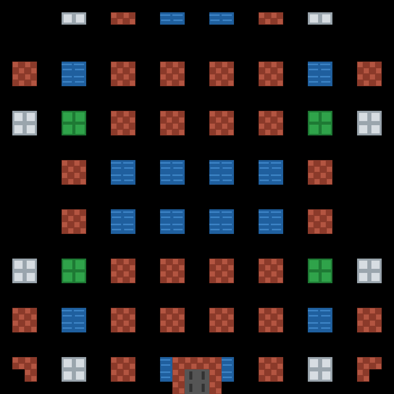

# 坦克大战 Battle City 🎮

经典《坦克大战》(Battle City) 的 HTML5 Canvas 复刻版,单文件实现,零依赖,打开即玩。



## 玩法

- **移动**:方向键 或 WASD
- **开火**:空格 或 J
- **目标**:消灭所有敌方坦克,同时保卫底部的基地(老鹰)。基地被摧毁或生命耗尽则游戏结束。

## 特性

- 🧱 地形系统:砖墙(可击碎)、钢板(满级火力可穿透)、水域(阻挡坦克)、树林(可隐蔽)
- 🤖 4 种敌人:普通、快速(蓝)、重甲(绿,3 HP)、强力(闪红光,高射速,70% 概率掉落道具)
- ⭐ 道具系统:星星(升级火力)、时钟(冻结敌军)、护盾、生命
- 🔊 WebAudio 合成音效(无外部音频文件)
- 🗺️ 每关程序化对称地图生成(768x768 大场景),难度递增
- 🤝 敌人 AI:巡逻漫游 + 瞄准玩家/基地,持续开火
- 🎯 火力三级升级:射速 → 弹速/双发 → 红色穿钢炮

## 运行

直接用浏览器打开 `index.html` 即可,或本地起一个静态服务器:

```bash
python3 -m http.server 8000
# 访问 http://localhost:8000
```

在线演示:见仓库 [GitHub Pages](https://handaichihu.github.io/battle-city-html5/)。

## 技术

纯原生 JavaScript + Canvas 2D,单文件 ~600 行,无框架、无构建、无依赖。

## License

MIT
